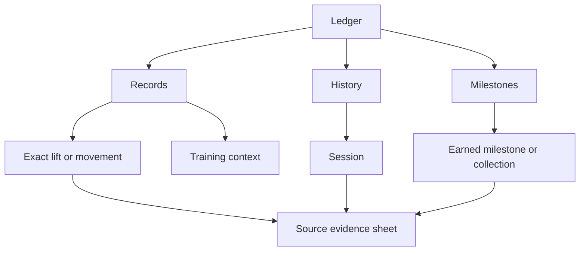

# Ledger navigation and visual direction — DEV storyboard

## Owner request and destination

October 30: completely rethink the Ledger and Strength Record. The current
experience has too many layers, feels convoluted and difficult to navigate,
and uses some image assets cheaply. Research modern, clean, sharp design
styles, develop a new structure and a storyboard in DEV, and explain the
directions. This is a design experiment for review, not a Production release.

## Acceptance and boundaries

- Audit current Ledger entry points, Strength, Achievements, Variants,
  Accessories, Journey, Archive, body and muscle context, and asset placement.
- Use primary industry guidance and real product examples; distinguish source
  observations from proposed Strength Ledger design decisions.
- Deliver a coherent interactive mobile storyboard in canonical DEV, with
  clear navigation, contextual records, source evidence, history, milestones,
  contextual body/training views and honest first-use states.
- Explain the hierarchy, proposed migration for all current destinations,
  visual style and reasons. Preserve an explicit way back and selected context.
- Inspect a first rendered pass, identify and correct the three weakest areas,
  then inspect a second pass at narrow and standard phone sizes. Check meaningful
  flows, units, keyboard/accessibility labels and visible tap targets.
- Use the existing authenticated DEV-only mock boundary; fictional records,
  no product API reads or writes inside the storyboard. Production Ledger,
  canonical account routing, subject ownership, record calculations and history
  remain unchanged. No backend, TestFlight, store build or release operation.
- Preserve approved art, runtime imagery and files. Any reduced ornament in
  the storyboard is a proposed placement change, not deletion or image approval.
- Core variants stay independent and grouped by parent lift. Machine records
  stay exact-brand/context scoped; assisted progress means less assistance.
  Performed values and calculated estimates must remain visibly distinct; a
  best-of-history sum is not a meet total. Sparse states invent no progress.
- Capture from canonical npm-start runtime and state the observed platform;
  browser phone-view evidence is not native-device certification. No simulator
  or native build is required for this isolated storyboard.

## Current audit

Completed source audit, research, proposed structure and executed DEV walkthrough follow below.

## Findings from the existing Ledger

Source audit: `components/ledger/routing.ts`, `index-experience.tsx`,
`StrengthExperience.tsx`, `AchievementsExperience.tsx`, `primitives.tsx`,
`lib/ledger-index-assets.ts`, and the existing route/evidence contracts.

The home offers six chapter entrances: Journey, Strength, Achievements,
Accessories, Variants and Archive. The route inventory also includes Muscle
Groups and Filters. Strength has Overview / Records / Analysis, followed by
Progression / Evidence / Standards within a selected lift. Achievements has
its own overview, clubs, tiers/trophies, medallions, milestones and PR history.

This creates three concrete orientation problems:

1. **Several plausible homes for the same question.** Personal records occur
   in the home, Strength Records and achievement PR history. Sessions occur
   in Journey and Archive. Variants appear in the Strength description and
   have a separate chapter. The person has to understand our organization
   before finding their own evidence.
2. **Navigation and data selection look alike.** Chapter entrances, primary
   tabs, lift panels, filters and collection selectors repeatedly change what
   is on screen. The current destination and a reliable return path are harder
   to infer than they should be.
3. **Decoration competes with facts.** A plate hero, chapter illustrations,
   equipment renders, counters, medallions and atmospheric headers all claim
   attention. A picture used to label a chapter does less useful work than a
   plainly named destination. Artwork quality and artwork placement are separate
   questions; this study changes proposed placement, not approval records.

Existing shortcuts are worth retaining: a recent PR already links directly to
its source. This proposal preserves that direct access. It does not claim every
existing path is slow, or that removing all visual character would improve it.

## Research and design direction

These are primary references, inspected October 30. Their principles inform the
proposal; the particular three destinations and screen compositions below are
our design hypotheses, not a rule issued by Apple or another product.

| Reference | Observed principle | Application in the study |
| --- | --- | --- |
| [Apple: Tab bars](https://developer.apple.com/design/human-interface-guidelines/tab-bars) | Clearly named destinations, predictable availability, preserved navigation state | Keep the app's Ledger location visible; give the Ledger three stable destinations and retain context when switching |
| [Apple: Charts](https://developer.apple.com/design/human-interface-guidelines/charts) | Explain a chart's meaning; retain units, scale and accessible inspection | Place the performed record before the chart; reuse the actual analytical chart and its dated observations |
| [Linear: UI redesign](https://linear.app/now/how-we-redesigned-the-linear-ui) | Refine hierarchy, alignment, density and navigation chrome; assess linked flows | Reduce competing headers and containers, then test a complete walkthrough rather than isolated attractive cards |
| [Oura: Using Trends](https://support.ouraring.com/hc/en-us/articles/360055983614-Using-Trends) | Distinguish a current metric from historical context and time range | Label the best recorded single separately from Session top loads and a chosen chart range |
| [Hevy: Exercise history](https://www.hevyapp.com/features/track-exercises/) | An exercise is a familiar entry point into its own performance history | Open an exact movement directly, then keep its records, context and underlying sets together |

Three useful visual families were considered:

| Direction | Strength | Tradeoff for this Ledger |
| --- | --- | --- |
| Technical editorial — selected | Strong typography, orderly data, restrained materials, clear hierarchy | Needs careful density so a clean page still contains useful evidence |
| Spacious health journal | Inviting summaries and approachable pacing | Large summaries and repeated cards can put essential lift records below the fold |
| Dense performance console | Fast comparison for expert users | Extra controls and compact labels can reproduce the orientation problem |

The selected treatment uses existing Exo 2 faces, charcoal surfaces, chalk actions,
clear separators and small amounts of meaningful lift color. A performed number
gets more emphasis than its container. Green communicates supported improvement;
gold marks recognition. Violet remains a brand/recognition accent. A simpler
background and fewer image-led entrances make the actual training record the
visual subject. This is not an app-wide theme change.

## Proposed information structure

Three destinations organize the questions a person is trying to answer:

- **Records:** What have I lifted, and how has this exact movement progressed?
- **History:** When did I do it, and what happened in that Session or block?
- **Milestones:** What has my recorded work earned, and what qualified it?

Core / Variants / Accessories are filters within Records. They are not separate
chapters with their own navigation systems. A lift has one profile: recorded
single, selected trend, rep records, a distinctly labelled calculated estimate,
and supporting reference context. Source evidence opens in a sheet, then returns
to the same profile or Session. History keeps filters, search, selected Session
and scroll context. Switching destinations preserves the destination's position.

### Where existing material goes

| Current material | Proposed home |
| --- | --- |
| Home / chapter index | Records becomes a useful landing screen, with all three core lifts visible first |
| Strength overview, progression, rep records and lift evidence | One exact-lift profile; source sets open in place |
| Strength analysis and standards | Contextual metric selection and reference information beside the lift |
| Core variants and variant families | Records → Variants, grouped by Squat / Bench / Deadlift; each movement keeps its own history |
| Accessory progress and equipment histories | Records → Accessories → exact movement and equipment context |
| Journey, blocks, phases, Sessions and Archive | One searchable History, with original program/block context and bounded older-history loading in implementation |
| PR history | History → Personal bests; the recent-PR shortcut remains direct |
| Plate clubs, strength tiers and total clubs | Milestones → named collections; qualifying performance and reference context stay available |
| Major volume awards and muscle-group medallions | Milestones → Volume awards, retaining governed families and unit-specific qualification |
| Bodyweight, muscle exposure and training volume | Records → Training context, with a route back to the contributing Sessions |
| Full source Session / Set / meet / video evidence | Existing canonical evidence destinations, reached contextually; no new ownership or writer |

This is a placement map, not a deletion list. All existing award inventories,
source evidence, historical identities, approvals and access rules are preserved.
The storyboard demonstrates representative paths, not production data migration.

## Nine-screen walkthrough

Open `http://127.0.0.1:8095/` while canonical `npm start` is running. On desktop,
use the numbered left rail and read the rationale at right. Within the phone,
use the actual Ledger controls. At phone widths, Next advances the walkthrough;
Example data opens its guide. The illustrated global app dock is orientation
context, not a simulation of the rest of the application.

1. **The record:** all three core lifts first. Inspect a lift or scroll to the
   recent five-rep record and open its source directly.
2. **A lift:** change 6 / 12 weeks, inspect the chart, change units and open a
   rep record. The estimated 1RM is explicitly separate from recorded singles.
3. **An exact accessory:** Hammer Strength assisted pull-ups show less assistance
   as an improvement. Life Fitness shows its own quiet first baseline.
4. **History:** search Squat or Upper and filter personal bests. Open a Session.
5. **Session proof:** inspect the exact performed set, expand the remaining sets,
   close the sheet and return. The Session's movement and equipment stay intact.
6. **Milestones:** earned club and next landmark, then clearly named collections.
   Open Strength tiers or Volume awards for their proposed presentation.
7. **A milestone:** a typographic earned threshold and the qualifying set. Switching
   units uses the existing unit-specific club boundaries, not a converted fake award.
8. **Training context:** reported bodyweight, completed work and labelled muscle
   exposure. No causal muscle-growth claim or cross-variant carryover is made.
9. **First week:** stable navigation, empty records and honest explanations. No
   mature history, bodyweight, standing or awards leak into this scenario.

Inside an authenticated native DEV app: Settings → Developer → Ledger Design
Study. That entry and its focused app-dock handling are development-only. The
browser viewer runs the same React Native study component with fictional data;
it does not bypass the real application's authentication or mount product APIs.

## Visual convergence and validation

The canonical `npm start` Metro runs on 8081; the loopback-only presentation host
on 8095 requests its actual React Native Web bundle. Fonts and icons are served
through that same Metro, not mocked screenshots or a different HTML design.
Early viewer setup exposed missing font delivery and an unconstrained root
viewport. Both were corrected before final acceptance; the browser guard now
requires a full, bounded phone surface and a visible app-navigation dock.

The first complete visual pass was inspected across all nine scenes. Three weak
areas were corrected:

1. The recent-PR card pushed a core lift below the fold. The core record now leads;
   the latest PR becomes a smaller, direct-access supporting card.
2. Repeated Ledger headings consumed detail space. Exact-lift, movement, Session
   and milestone pages now use a compact persistent navigation header and an
   explicit, named Back control.
3. The milestone image still read as decoration. The revised detail uses a
   typographic threshold and qualifying evidence. Image files and approvals were
   preserved; this is a placement proposal for owner review.

Second-pass captures were inspected after those corrections. Subsequent actual
browser checks cover both Chromium and WebKit, all nine scenes at 360×780,
390×844 and 430×932, and the desktop study. Key return/filter/unit/ownership-context
flows are exercised against the rendered components. The actual chart is reused;
changing the range changes the plotted observations. All visible study buttons,
tabs and inputs in the measured phone surface retain at least 44px targets.

Executed evidence is retained in `docs/validation/ledger-study-2026-10-30/`:

- TypeScript: PASS.
- Fixture/semantic boundary checks: 18 PASS.
- Browser workflow groups: 36 PASS across Chromium and WebKit.
- Responsive scene captures: 54, plus source sheets, collections and desktop.
- Pointer-to-paint: below 200ms; Chromium checked at 4× CPU slowdown.
- Product-service requests and mutation requests from the isolated viewer: 0.
- Actual browser selection semantics, Escape-to-close, filtered Back return,
  preserved tab context, equipment isolation and first-week state separation: PASS.

The broader existing UI-constitution audit still reports five findings outside
this study, in AthleteHomeV3, SignupWelcome, session-follow-through and login.
The new study adds no raw color/font-size/radius/shadow findings. No exception
register or protection pin was refreshed to hide those existing findings.
This DEV proposal is not a whole-app release certification.

## Architecture and delivery closeout

The changed state machine is local storyboard navigation and fictional example
selection. No authentication, billing, linking, actor ownership, execution access,
record writer or backend state machine was changed. The adjacent application
surfaces are the Settings Developer entry and one exact DEV-only focused route;
all production Ledger routes and experiences remain untouched.

Confidence is scoped to the executed fixture consistency, TypeScript, actual
browser flows and source boundaries. Native-device interaction, real-data binding,
full history pagination and empirical user usability testing belong to a later
implementation/promotion phase. No simulator build, OTA, TestFlight publication,
store action or Production deployment was performed for this design study.

Recommended next design review: find a five-rep best; inspect an assisted-machine
record; locate a past Session; find a club's qualifying set; then return without
restarting the task. The owner can use this concrete prototype to judge the
navigation and visual direction before authorizing a product migration.
