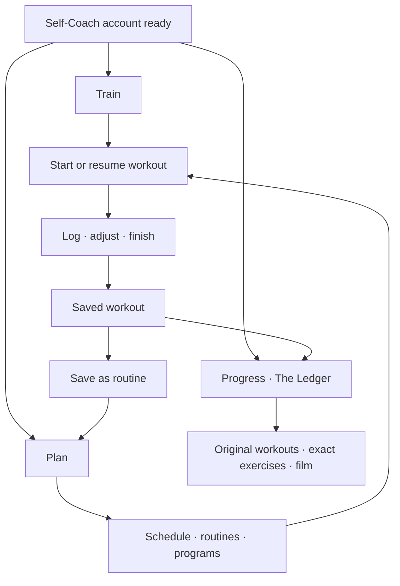

# Self-Coach mobile rebuild proposal

November 10, 2026 · Canonical DEV · Mobile 3.0 · Research and proposal

## Request and acceptance

The owner requests a complete rethink of Self-Coach mobile UI, UX and workflows, supported by research and a phased implementation plan. A new user should be able to sign in, understand the available actions and start recording training without a tutorial. The current UX does not constrain the proposed information architecture. This proposal replaces the incremental navigation and implementation recommendations in the earlier [usability audit](../audits/SELF_COACH_USABILITY_2026-11-10.md).

The scope covers account entry, first arrival, everyday training, planning, reuse, scheduling, active logging, completion, history, records, film, meets, help and recovery. Mobile establishes the model before web adaptation. The requested destination for this run is a researched proposal in canonical DEV for owner review. Application implementation and release are subsequent work.

Acceptance for the proposal means a concrete destination structure, connected workflows, visual direction, a destination for every existing capability, implementation dependencies and measurable exit gates. Recommendations are identified as product proposals. Existing account, access, equipment, movement identity and historical evidence laws remain engineering requirements.

## Product direction

**Someone who knows what they want to train should be able to open Strength Ledger and get on with it. Someone who wants to plan ahead should be able to build structure gradually. Both should understand what they did and find it again.**

Build the mobile experience around three intentions.

| Destination | Question it answers | Main contents |
| --- | --- | --- |
| **Train** | What am I doing now? | Start, today's workout, active workout, resume and relevant recent training |
| **Plan** | What will I do next? | A week schedule, reusable routines and optional multiweek programs |
| **Progress** | What have I done, and what is changing? | The Ledger, workout archive, exercise history, records, film and milestones |

Profile, account, subscription, preferences and support belong behind a consistently placed profile control. An active workout has a persistent compact return control outside its screen. The owner's floating glass navigation row is a required part of the proposed shell. Its capsule, translucent material, selected lens and floating placement carry the proposed destinations. Navigation labels and remembered destination position support first-use orientation.

Use **Training Session** for a dated training occurrence, **Session** in shorter controls, **routine** for reusable exercises and set structure, and **program** for an optional sequence of weeks. Use **exercise** in everyday controls while retaining exact governed movement identities underneath. The owner reaffirmed the terminology in the release constitution after the Phase 1 handoff. Apply it to every label in the implementation, including where the original storyboards and examples below show the superseded wording.

The label **Progress** is a proposal for easier first-use recognition. **The Ledger** remains the page title and the name of the training record. Test whether new users understand that relationship before locking the labels.

This is a proposed information architecture. The three-destination arrangement is a design judgment to validate with users.

## Companion storyboards

The owner's subsequent aesthetic correction requires the base dark theme, purple accent and existing floating glass navigation row. The [v2 visual direction](self-coach-mobile-rebuild-storyboards/VISUAL_DIRECTION_V2.md) records the inspected visual references and supersedes the first boards' formatting and fixed bottom-bar treatment. The workflow structure remains a proposal for review.

Four revised concept boards now show 13 proposed mobile screens with illustrative data and the required floating glass dock. The [storyboard guide](self-coach-mobile-rebuild-storyboards/README.md) records the flows, visual review, research and exact prompts. The original set remains as design history.

| Board | Connected flow |
| --- | --- |
| [First workout](self-coach-mobile-rebuild-storyboards/01-first-workout-v2.png) | First arrival, exercise search, logging and completion |
| [Planning](self-coach-mobile-rebuild-storyboards/02-plan-v2.png) | Routine creation, week agenda and contextual rescheduling |
| [The Ledger](self-coach-mobile-rebuild-storyboards/03-ledger-v2.png) | Visual progress, exact exercise history and original video evidence |
| [Return and recovery](self-coach-mobile-rebuild-storyboards/04-return-recovery-v2.png) | Resume, interrupted-save recovery and contextual support |

## What the actual audit established

The [audit and evidence](../audits/SELF_COACH_USABILITY_2026-11-10.md) used a persisted Self-Coach account in the normal iPhone development app, with server-verified individual workspace, self-link and access. The first training and returning flows revealed five structural problems.

1. First arrival displays rest-day language, readiness, bodyweight, history shortcuts, weekly counts and empty trends before there is any training to interpret.
2. Planning introduces programs, blocks, weeks, assignments and prescriptions before the user has a reason to organize at that level.
3. Creating, saving, previewing, making ready and starting a workout use different screens and unclear completion states. The recorded route took eight taps from creation to the active logger, before opening the first set.
4. The same work is fragmented across Today, Programming, Calendar and several history routes. A saved standalone draft was hard to rediscover. Reuse failed for a user without a program.
5. Movement discovery expects the user to know our Core and Accessory classification. Searching for Goblet Squat failed until the category changed.

The audit also reproduced missing recovery, inconsistent units and an unexplained first load target. Those are implementation dependencies. Correcting them alone would leave the structural problems above.

## Research and how it informs this proposal

These are official published product flows and design guidance. Hevy and Things published screenshots were visually inspected. The research does not establish hands-on testing of the current installed versions of every reference app.

| Reference | Relevant pattern | Proposed adaptation |
| --- | --- | --- |
| Hevy | Immediate workout entry and reusable routines are distinct, directly usable concepts | Train supports immediate logging. Plan stores routines that can be started or scheduled. [Official explanation](https://help.hevyapp.com/hc/en-us/articles/33703513582871-Workouts-vs-Routines-in-Hevy-What-They-Mean-and-How-to-Use-Them) |
| Hevy logging | Previous values, local exercise adjustments and rest timing sit beside the work | Keep the current set, its comparison and its controls together. [Official logging flow](https://www.hevyapp.com/features/track-workouts/) |
| Fitbod | Exercise editing remains available before and during a workout, with search and optional refinements | Use one exercise picker and one consistent editing vocabulary across planning and training. [Official editing guide](https://help.fitbod.me/hc/en-us/articles/360006335593-Editing-Workouts-in-Fitbod) |
| Strong | Completed work can become a reusable template | Offer Save as routine after completion and from workout detail. This guide was updated in 2021, so it supports the pattern rather than a claim about the latest UI. [Official template guide](https://help.strongapp.io/article/105-about-templates) |
| Things | Present and future work have explicit meanings, with scheduling close to the item | Carry the chosen day through creation and editing. Distinguish unscheduled time from a deliberate rest day. [Official scheduling guide](https://culturedcode.com/things/support/articles/2803579/) |
| Todoist | Quick creation accepts the central item first, with additional properties available nearby | Build a workout by choosing exercises. Offer dates, organization and advanced settings as the need arises. [Official Quick Add guide](https://www.todoist.com/help/todoist/features/use-task-quick-add-in-todoist-va4Lhpzz) |
| Oura | Relevant current information and longer-term interpretation have separate homes | Train prioritizes the present. Progress carries deeper analysis and the archive. Sparse data receives an explicit treatment. [Official app guide](https://support.ouraring.com/hc/en-us/articles/360058599753-How-to-Use-the-Oura-App) |
| Apple | Brief onboarding, learning through use, contextual help and recognizable navigation | Reach useful training quickly. Explain an unfamiliar control where it is encountered. Keep destination labels visible. [Onboarding](https://developer.apple.com/design/human-interface-guidelines/onboarding), [tab bars](https://developer.apple.com/design/human-interface-guidelines/tab-bars) |
| Nielsen Norman Group | Progressive disclosure can reduce initial complexity when secondary controls are clear and findable | Keep frequent training actions visible. Place specialist settings beside the relevant exercise or plan. Test discovery instead of assuming hidden controls are understandable. [Progressive disclosure](https://www.nngroup.com/articles/progressive-disclosure/) |

The adaptation is specific to Strength Ledger. Its exact movement histories, governed equipment comparisons, original video evidence and multiweek training remain valuable. The proposed UX introduces those capabilities when the task calls for them. Research here concerns interaction patterns and does not authorize generated training prescriptions or changes to existing coaching policy.

## The proposed mobile experience

### 1. Entry and first arrival

Keep account entry short and explicit about Self-Coach. Present the actual verification and subscription requirements with understandable status, a way to resume interrupted setup and contextual help. Avoid asking for maxes, a complete program, bodyweight and notification permissions before their related features are needed. Apple recommends postponing nonessential setup and introducing features through interaction. [Apple onboarding](https://developer.apple.com/design/human-interface-guidelines/onboarding)

Once the server declares the account ready, open Train. A fresh account gets a brief welcome, a dominant **Start workout** action and a quieter **Build a routine** action. The explanation can fit in one sentence. The screen gains recent training and useful progress as real evidence accumulates.

Account setup must show the same trust model as training. Display which step is pending, retain entered information safely, offer the next valid action and make support reachable from the failing step. Product access continues to follow the canonical server state.

### 2. Train has a clear next action

| Actual state | Dominant action | Supporting content |
| --- | --- | --- |
| Active workout | **Resume workout** | Exercise name, saved progress and elapsed time |
| Ready workout scheduled today | **Start workout** | Workout identity, exercise preview and optional readiness |
| Fresh account with no plan | **Start workout** | Build a routine |
| Returning account with no workout scheduled | **Start workout** | Repeat last workout and the next scheduled workout, when present |
| Just completed | **View workout** | A concise saved result and the next relevant training action |

Resolve those states in a defined order. An active workout always wins. A blank date uses plain unscheduled language. A deliberate rest day can be shown when one was actually recorded.

Train should normally have one dominant action and at most two supporting sections. Longer-term charts, multiple history shortcuts and the full weekly dashboard move to their task destinations. The amount of content follows the person's actual training state.

### 3. Starting and logging form one continuous workflow

The target path is **Start workout → choose exercise → enter first set → save**. Exercise selection opens the workout's working surface directly. A separate authoring wizard is unnecessary for immediate training.

Search all eligible exercises initially. Recent and favorite choices can accelerate returning use. Equipment and movement-class refinements remain optional controls. Choosing an exercise retains its exact governed identity. Any equipment setup necessary to record comparable evidence appears beside that selection.

Within the workout, show a compact exercise outline, a focused current exercise and its set rows. Weight and reps are directly editable with suitable numeric keyboards. Duration and other measurement modes follow the selected exercise. The previous comparable performance has a compact, clearly labeled place. Actual performed inputs remain distinct from a planned target.

Keep **Add set**, **Add exercise** and **Finish** visible. Put exercise replacement, reordering and specialist set options in a menu attached to the exercise. Swipes may accelerate actions, with a visible equivalent. Back and closing an editor preserve entered work and return to the same context.

For quick workouts, I propose making recorded effort optional. Programs that request effort still show that target clearly. This changes a current recording expectation and requires explicit owner review before its data contract is altered. Missing maxes or history must produce an honest empty target instead of an invented working load.

The logger keeps the established near-black material, compact history, cyan remaining-time ring and precise completion signals. Rest controls stay compact and available without obstructing the next set. This reconciles the rebuild with [Logger Option E](../LOGGER_OPTION_E.md).

Saving must be understandable under real network conditions. Show pending, saved and failed states at the affected set. Preserve typed input, reconcile an uncertain server response before retrying, and keep retries from creating duplicate sets. Resuming after backgrounding or relaunching must recover the same workout and saved evidence.

### 4. Finishing makes the next visit easier

The completion screen leads with recorded work, useful change and any result that qualifies under the existing rules. A partial workout clearly identifies unrecorded work. Notes, reflection, film and deeper analysis remain available from the workout.

Offer **Save as routine** after a useful first workout. Repeating a completed workout creates a new occurrence with an explicit choice about carrying its exercise structure and targets. A historical workout remains an original record. Editing today's occurrence has a clear scope. Updating the reusable routine is a separate, explicit choice.

The person can return from their result to Train, schedule the routine or inspect its original evidence. Each route preserves its source context.

### 5. Plan supports structure at several levels

Plan opens with a compact week strip and agenda, followed by a concise reusable-routine section. An empty account receives a useful creation action. Existing scheduled work and saved routines receive the space as they accumulate.

- **Schedule a workout.** Tap a day, choose an existing routine or build a workout, then save it to that day. The date remains visible throughout. Starting now and scheduling later have distinct actions.
- **Build a routine.** Choose exercises, arrange sets and save a named reusable structure. A title can be suggested for the routine and edited later. The user does not need to create a multiweek program first.
- **Repeat recent training.** Start a new occurrence or schedule it. Present the source date and exact exercises so the choice is recognizable.
- **Adjust the week.** Reschedule, copy or cancel from the affected workout. Show the destination date and what changes before confirmation. Preserve completed evidence.
- **Build a program.** Provide a clearly named Programs entry for people who want weeks, blocks, progression and templates. Show the current program and week in schedule context once one exists. Full program editing has its own workspace.

The week strip can open a month picker for longer jumps. It does not need a separate bottom tab. Drafts have an identifiable place beside planned work. Their visibility follows author ownership, while the server continues to decide whether they are executable. Selected dates, scroll position and editing context survive a round trip.

This moves calendar, routines and program organization into one planning destination. A common workout remains recognizable whether it began from a blank start, a routine or a program.

### 6. Progress makes the record understandable

The Progress destination opens **The Ledger**. Its initial view gives a visual account of actual training, with a compact activity calendar, meaningful strength trends and recent evidence. First-time and sparse-data states grow into this composition as evidence becomes available.

The full archive uses a date-oriented visual navigator and search. Selecting a date or period reveals the matching workouts. Film can show actual video previews, and meets can show event and attempt context. Records can use charts with direct links to the original supporting sets. These are different presentations of the same evidence, with consistent filtering and return behavior.

Use a single clear archive filter attached to its trigger for Training, Records, Film and Meets. Avoid stacked navigation strips. Exercise details hold exact movement history, comparable records, trends and source workouts. Core lifts, custom variants and accessories remain discoverable through search and optional classification. Milestones appear as earned evidence with an entry to the full collection.

Charts state their metric, unit, time range and grouping. One observation receives a first-record treatment. A weekly bucket is labeled as a week. Estimates are labeled and kept distinct from performed loads. Planned and performed counts use explicit names. User-selected units apply to rows, details, axes and summaries.

### 7. Help and recovery belong to the task

Every failed loading or saving state retains a useful route forward. Show local Retry where it can help, keep Back usable and preserve entered work. When authentication or access has changed, explain the next valid recovery action. Cached content must communicate its freshness.

**Get help** on a persistent failure opens a short report with the screen, operation, app version and safe diagnostic reference already attached. The person can add a message, review what is shared and submit. Confirm receipt with a reference they can retain. Delivery to the owner's existing support destination must be verified during implementation. Private credentials, payment details and arbitrary training payloads stay out of diagnostics.

Support supplements reliable recovery. A restored connection should allow the current screen to recover without forcing the person to discover a navigation workaround.

## Visual and interaction system

The owner's latest visual direction preserves the base dark theme, purple brand accent and floating glass navigation row while rethinking composition, typography, controls and formatting. Use deep charcoal with a subtle plum undertone, readable off-white text, clearly ranked numbers and selective surface elevation. The [revised visual direction](self-coach-mobile-rebuild-storyboards/VISUAL_DIRECTION_V2.md) and companion boards show the proposed aesthetic. Earlier [Ledger reference work](OPERATION_VISUAL_CLEANUP_2026-10-30.md) retains the requirements for meaningful visualization, purposeful artwork and comfortable density.

| Element | Proposed treatment |
| --- | --- |
| Atmosphere | Deep charcoal with a plum undertone, subtle tonal separation and selective surface elevation |
| Imagery | Original approved movement art integrated into backgrounds, with a protected visible subject and foreground contrast |
| Main action | One consistent high-emphasis treatment |
| Navigation | Canonical floating glass capsule, highlighted edge, selected purple lens and visible safe-area separation |
| Status | Existing scoped violet/green meanings, cyan timer/information, amber waiting and explicit error treatment, always paired with text or an icon |
| Type | Clear title, exercise, metric and supporting-text roles. Large numbers belong to the current task |
| Density | Compact repeated gaps, a restrained 4/8/12/16/20 spacing scale and one layer of container inset per group |
| Controls | Familiar buttons, direct fields and anchored menus. A focused sheet is appropriate for bounded editing, with an unambiguous return |
| Data visualization | Useful axes, units, dates, source links and sparse-data states. Semantics determine color |

Original artwork should identify movement and give the app character. Each composition needs actual subject inspection, especially Squat, Bench and Deadlift. Preserve approved source pixels and the prohibition on square movement thumbnails. Match the established canonical anatomy and milestone resources to their intended uses.

Keep page titles and header actions stable. Local navigation menus open beside their trigger. Set entry keeps the active row above the keyboard, advances naturally between numeric fields and leaves completion reachable. Switching destinations preserves an active workout and each destination's position. Editing presents an explicit save state, with a clear discard choice when leaving unsaved work.

Compact layout must preserve interaction targets. Android guidance recommends at least 48 dp touch areas. Adopt a 48 logical-unit default for repeated mobile controls and verify each platform's native behavior. Text contrast should meet WCAG AA thresholds, including text over artwork. Validate large text, screen readers, reduced motion and status comprehension without color. [Android accessibility](https://developer.android.com/guide/topics/ui/accessibility/apps), [W3C contrast guidance](https://www.w3.org/WAI/WCAG22/Understanding/contrast-minimum.html)

## Where existing capabilities go

This inventory establishes coverage for the rebuild. Phase 0 must reconcile it against the actual Self-Coach route and capability inventory before implementation.

| Capability | Proposed home or entry |
| --- | --- |
| Immediate training and active resume | Train |
| Exercise search, favorites and recent choices | Shared picker in training and planning |
| Set logging, edits, warmups, supersets and rest | Active workout, attached to its exercise or set |
| Equipment setup and comparison context | Exercise setup and exact exercise history |
| Readiness and bodyweight | Optional relevant Train entry, historical detail in Progress |
| Routine and standalone workout creation | Plan, with immediate start also available from Train |
| Session, week and block template reuse | Plan library and program workspace at the relevant scope |
| Multiweek program creation and editing | Plan → Programs |
| Calendar and rescheduling | Plan week agenda and month jump |
| Author-owned drafts | Plan, alongside upcoming work with an explicit state |
| Recaps and original completed workouts | Completion and Progress archive |
| Core lifts, custom core variants and accessories | Shared picker and exact exercise detail in The Ledger |
| Personal bests, estimates and rep records | Progress, with provenance and governed comparison scope |
| Film, review evidence, uploads, playback and export | Original workout/set plus searchable Film archive |
| Meets and attempts | Upcoming event planning in Plan, recorded events in Progress |
| Milestones and achievements | Progress summaries and full collection |
| Muscle and training-volume analysis | Relevant Progress drill-down using canonical anatomy |
| Training maxes and advanced prescription settings | Relevant exercise or program, with a stable settings entry |
| Education and contextual tips | The relevant task, with replay from profile/help |
| Account, email verification, subscription and preferences | Entry/resume state and profile |
| Feedback and support | Failed task and profile/help |
| LedgerBot assistance | Contextual permitted assistance using the existing governed tool boundary |

## Phased implementation plan

Phases produce complete connected flows in canonical DEV. Owner review happens on actual app screens with representative Self-Coach data. The sequence is dependency-based. Calendar estimates should follow the Phase 0 contract assessment, particularly immediate training, routine reuse and durable saves.

| Phase | Implementation scope | Reviewable result and exit gate |
| --- | --- | --- |
| **0 · Blueprint and contracts** | Confirm the full capability map, three-destination structure, terminology, key screen compositions and critical states. Cover first arrival, active workout, completion, Plan, The Ledger and exact exercise history. Reconcile workout/routine/program semantics with actual APIs. Decide required effort, instance/routine edit scope and pending-save behavior. Map required backend changes and preserve owner laws | An approved connected flow from arrival to first set, finish, repeat, schedule and original history. Every feature has a destination. Existing IDs and record scopes have an explicit preservation plan |
| **1 · First workout and return** | Build the shared visual system and labeled navigation, Train states, immediate workout start, shared exercise picker, direct logging/editing, compact rest, completion, resume and repeat. Include missing-target correction, standalone reuse and local retry recovery as dependencies | A fresh Self-Coach can log, edit, finish, reopen and repeat a real workout through normal entry points. A returning user resumes the same evidence after interruption. First and second screenshot passes meet the visual benchmark |
| **2 · Planning that feels natural** | Build the week agenda, routine creation, scheduling, drafts, rescheduling and explicit occurrence/routine edits. Adapt complete program, week, block and template workflows to the new structure | A person can train immediately or build and schedule reusable training. Structured lifters can manage a real multiweek plan. A selected date survives creation and Back. Drafts are discoverable and execution remains server-governed |
| **3 · Complete training record** | Recompose The Ledger and visual archive. Integrate exact exercise history, governed records, charts, film, meets, milestones and contextual bodyweight/readiness history. Correct unit and count inconsistencies | Existing and newly recorded evidence reconcile with canonical data. Users find an old workout, its exact set and its video, then return to the same filter/date. Sparse and extensive histories both render coherently |
| **4 · Entry, resilience and accessibility** | Complete setup/resume, verification and checkout-return coverage. Finish contextual support delivery, media recovery, slow-network/relaunch behavior, large text, screen-reader and platform navigation passes. Reliability coverage starts in Phase 1 and expands in every phase | All ready and interrupted account paths have a valid next action. Failed writes retain input and reconcile safely. Help delivery is confirmed. iOS and Android complete the realistic task matrix with measured response behavior |
| **5 · Usability pilot and controlled rollout** | Observe new-to-app users across novice and experienced lifters. Fix the largest remaining navigation and comprehension failures. Complete owner visual review and the Mobile 3.0 release gates for any separately authorized release. Adapt the accepted workflow model to web afterward | The task acceptance below passes. No known data-loss or access regression remains. Release evidence identifies the exact artifact and observed scope. Web follows the accepted mental model while using desktop-appropriate layouts |

The first implementation milestone is the complete Phase 1 training loop. Its review should establish whether the new experience feels natural before the same decisions spread across planning and analysis.

## Validation and success criteria

### Usability

Recruit eight people unfamiliar with Strength Ledger, including people experienced with lifting and people new to logging. Include iOS and Android. Give task goals without a walkthrough, observe wrong turns and ask what they expect each action to do.

Proposed pilot thresholds are at least seven of eight completing each core task without assistance, with every failure documented and corrected before broad rollout. This is a formative pilot threshold and does not establish statistical population performance.

1. Start an unplanned workout and save the first set.
2. Change a set, add an exercise, leave the workout and resume it.
3. Finish, find the saved result and repeat the workout on another day.
4. Build a routine, schedule it and move it to another date.
5. Find an older workout, its original set and attached film.
6. Recover from an interrupted save or explain the visible next step accurately.

Also measure time, taps, backtracking, mistaken expectations and confidence about whether work was saved. Compare with the recorded audit paths. Users knowing their first exercise should reach active logging within 60 seconds of an already-ready account arrival, with no required tour. Treat that as a proposed target to test.

### Correctness and recovery

Cover a fresh account, standalone training, a routine user, a multiweek program user and a large historical account. Include kg/lb, zero-load bodyweight edits, lower-is-better assistance, exact variants and manufacturer-separated equipment. Test save timeout after server acceptance, repeated taps, edits racing with refresh, backgrounding, relaunch, revoked access and restored connectivity. Original set identities and histories must reconcile without duplicates.

Use actual-handler/API checks and normal app entry points. Isolated screenshots and passing type checks cannot establish connected workflow behavior. Validate readiness and billing separately from the training UX, including live-service evidence only when it was actually obtained.

### Visual and performance

Inspect actual canonical DEV screenshots against the approved visual references. Identify the three weakest areas, correct them and inspect a second pass. Cover empty, active, populated and failed states, a small phone and large text. Verify image subjects, chart labels and all selected units.

Measure input feedback, save acknowledgement, first useful screen and archive/media loading on named devices and controlled network profiles. Present local input feedback immediately, represent server acknowledgement separately and keep video work from blocking logging or navigation. Set numerical latency budgets after a baseline measurement, then retain regressions against the accepted targets.

## Engineering boundaries and dependencies

The proposed state machines cover navigation, account readiness, plan/draft/scheduled state, active/completed workouts, local edit/pending-save state and media transfer state. Adjacent systems include entitlement, AuthContext, self-links, training APIs, recognition, equipment governance, templates, history, video and education.

Use the canonical Self-Coach identity and server-owned access. Keep the existing workout and set identities behind new labels. A completed original remains traceable through every chart, record and media view. Equipment identity, cable-brand policy, assistance direction, zero-load validity and exact custom-variant history require regression coverage. Existing APIs may be reused where their behavior supports the proposed flow. Required contract changes belong in the same accepted slice as their mobile consumer.

Immediate start, standalone reuse and the proposed optional effort behavior need explicit contract reconciliation in Phase 0. Robust pending-save behavior requires durable request identity, revision handling and reconciliation. A full offline workout-creation model needs a separate feasibility decision there. Phase 1 still requires input retention and safe retry for interrupted requests.

Education state remains scoped to the canonical user, with AuthContext owning readiness and mobile mode. LedgerBot remains within the existing owner-approved assistance boundary. Approved imagery, anatomy, release protections and historical runtime evidence remain governed inputs. Mobile 3.0 is the target runtime.

## Evidence status and closeout

This proposal combines the actual DEV iPhone Self-Coach audit, source inspection and official published research. The QA account had a development billing exemption. The audit does not prove production signup, live email delivery, live Stripe completion, native store behavior, Android usability or novice participant results.

The design decisions in this document are recommendations for owner review, including the three main destinations, user-facing terminology, optional quick-workout effort and the proposed pilot thresholds. No application source or product behavior was changed for this proposal. Production, mobile publication and device certification have no new validation result from this work.
